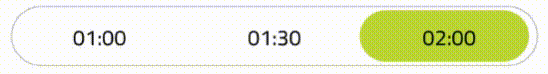

# SwitchSelector

Switch Selector to React Native.

[](https://badge.fury.io/js/react-native-switch-selector)
[](https://www.npmjs.com/package/react-native-switch-selector)

### SwitchSelector



### SwitchSelector - Custom Example


### Installing

```Shell
yarn add react-native-switch-selector
```

or

```Shell
npm i react-native-switch-selector --save
```

React and React Native are peer dependencies and must be provided by the app.
The peer dependency ranges are intentionally permissive; an installable version
is not necessarily a tested version. The JavaScript and TypeScript compatibility
checks cover React Native 0.76, 0.86, 0.87, and 0.88. They do not establish native
platform compatibility on their own.

A limited iOS simulator smoke test on React Native 0.88.1 verified rendering and
a programmatic selection. Native touch gestures and Android have not been verified.

### Usage

```js
import SwitchSelector from "react-native-switch-selector";
```

```js
const options = [
  { label: "01:00", value: "1" },
  { label: "01:30", value: "1.5" },
  { label: "02:00", value: "2" }
];
```

you can also add `testID` and `accessibilityLabel` to each option:

```js
const options = [
  { label: "01:00", value: "1", testID: "switch-one", accessibilityLabel: "switch-one" },
  { label: "01:30", value: "1.5", testID: "switch-one-thirty", accessibilityLabel: "switch-one-thirty" },
  { label: "02:00", value: "2", testID: "switch-two", accessibilityLabel: "switch-two" }
];
```

```js
<SwitchSelector
  options={options}
  initial={0}
  onPress={value => console.log(`Call onPress with value: ${value}`)}
/>
```

### Custom Example

```js
<SwitchSelector
  initial={0}
  onPress={value => this.setState({ gender: value })}
  textColor={colors.purple} //'#7a44cf'
  selectedColor={colors.white}
  buttonColor={colors.purple}
  borderColor={colors.purple}
  hasPadding
  options={[
    { label: "Feminino", value: "f", imageIcon: images.feminino }, //images.feminino = require('./path_to/assets/img/feminino.png')
    { label: "Masculino", value: "m", imageIcon: images.masculino } //images.masculino = require('./path_to/assets/img/masculino.png')
  ]}
  testID="gender-switch-selector"
  accessibilityLabel="gender-switch-selector"
/>
```

### Props

| Prop                         | Type                    | Default     | Required | Note                                                                             |
| -------------------------    | ----------------------- | ----------- | -------- | -------------------------------------------------------------------------------- |
| options                      | array                   | []          | true     | Items to render. Each item has a label, value, and optional icons.                |
| options[].label              | string                  | —           | true     | Label from each item                                                             |
| options[].value              | string \| number        | —           | true     | Value from each item                                                             |
| options[].customIcon         | React node \| function  | undefined   | false    | Icon or a function called with whether the item is selected                     |
| options[].imageIcon          | Image source            | undefined   | false    | React Native image source, such as `require(...)` or `{ uri: '...' }`            |
| options[].activeColor        | string                  | undefined   | false    | Color from each item when is selected                                            |
| options[].disabled           | bool                    | false       | false    | Disables presses on this option; swipes and `value` can still select it           |
| options[].testID             | string                  | undefined   | false    | Test ID for each item used for testing (e.g. with Appium)                        |
| options[].accessibilityLabel | string                  | undefined   | false    | Accessibility Label for each item used for testing (e.g. with Appium)            |
| initial                      | number                  | -1          | false    | Initially selected index; `-1` leaves all items unselected                      |
| value                        | number                  | 1           | false    | Option index applied when this prop changes after mount; see `initial`           |
| onPress                      | function                | null        | false    | Callback called with the selected value, or the option when `returnObject` is set |
| disableValueChangeOnPress    | bool                    | false       | false    | Suppresses the onPress call when the `value` prop changes                        |
| fontSize                     | number                  | 14          | false    | Font size from labels                                                            |
| selectedColor                | string                  | '#fff'      | false    | Color text of the item selected                                                  |
| buttonMargin                 | number                  | 0           | false    | Margin of the item selected to component                                         |
| buttonColor                  | string                  | '#BCD635'   | false    | Color bg of the item selected                                                    |
| buttonStyle                  | View style              | {}          | false    | Style for the animated selection indicator, such as a shadow                     |
| textColor                    | string                  | '#000'      | false    | Color text of the not selecteds items                                            |
| backgroundColor              | string                  | '#ffffff'   | false    | Color bg of the component                                                        |
| borderColor                  | string                  | '#c9c9c9'   | false    | Border Color of the component                                                    |
| borderRadius                 | number                  | 50          | false    | Border Radius of the component                                                   |
| hasPadding                   | bool                    | false       | false    | Indicate if item has padding                                                     |
| animationDuration            | number                  | 100         | false    | Duration of the animation, in milliseconds                                       |
| valuePadding                 | number                  | 1           | false    | Size of padding                                                                  |
| height                       | number                  | 40          | false    | Height of component                                                              |
| bold                         | bool                    | false       | false    | Indicate if text has fontWeight bold                                             |
| textStyle                    | object                  | {}          | false    | Text style                                                                       |
| selectedTextStyle            | object                  | {}          | false    | Selected text style                                                              |
| textContainerStyle           | object                  | {}          | false    | Style for text (and icon) container (TouchableOpacity)                           |
| selectedTextContainerStyle   | object                  | {}          | false    | Style for selected text (and icon) container (TouchableOpacity)                  |
| activeOpacity                | number                  | 0.2         | false    | Opacity of an option while it is pressed                                         |
| touchableProps               | TouchableOpacity props  | {}          | false    | Additional props forwarded to each option's TouchableOpacity                     |
| textCStyle                   | object                  | —           | false    | Deprecated type-only prop; ignored at runtime. Use `textContainerStyle`.          |
| imageStyle                   | object                  | {}          | false    | Image style                                                                      |
| style                        | object                  | {}          | false    | Container style                                                                  |
| returnObject                 | bool                    | false       | false    | Indicate if onPress function return an option instead of option.value            |
| disabled                     | bool                    | false       | false    | Disables presses and swipes; `value` can still change the selection              |
| borderWidth                  | number                  | 1           | false    | Border width, applied when `hasPadding` is true                                  |
| testID                       | string                  | null        | false    | Test ID used for testing (e.g. with Appium)                                      |
| accessibilityLabel           | string                  | null        | false    | Accessibility Label used for testing (e.g. with Appium)                          |

`initial` determines the selected index when the component is created. Changing
`value` after mounting selects that index and normally calls `onPress`; the
`disableValueChangeOnPress` prop suppresses that callback for prop-driven changes.
When a selection change is processed without calling the callback, the current
implementation logs the selected value.
The declaration still accepts a string for `imageIcon` for backward compatibility,
but React Native image sources should use a supported source such as `require(...)`
or `{ uri: '...' }`. Selected text and container styles are used instead of their
unselected counterparts, rather than being merged with them.

`buttonStyle` is applied to the animated indicator after its calculated styles;
overriding its dimensions or transform can affect layout or animation. The
indicator's absolute positioning and zero border width are enforced by the library.

`touchableProps` supplies additional props to every option. The component's own
`disabled`, `style`, `onPress`, `accessibilityLabel`, and `testID` take precedence.
For opacity, an explicit `activeOpacity` takes precedence over
`touchableProps.activeOpacity`; if neither is provided, it defaults to `0.2`.

### Development and compatibility checks

Use Node 22.13 or newer in the Node 22 line, Node 24.3 or newer in the Node 24
line, or Node 26 or newer. Install the development dependencies with `npm ci`,
then run:

```sh
npm run lint
npm test
npm run typecheck
npm run test:compatibility
```

The compatibility command packs the library and installs it into temporary
consumer projects for each version listed above. It requires network access and
can also run one version, for example `npm run test:compatibility -- 0.76`. It
checks the library's declaration and a TypeScript consumer separately from
React Native's own declaration files. The tests mock native APIs and do not
replace iOS or Android runtime testing.

### Authors

- Lucas Santana Carneiro - [jkdrangel](https://github.com/jkdrangel)
- Cássio Silva de Sá Santos - [ssscassio](https://github.com/ssscassio)
- [Contributors](https://github.com/App2Sales/react-native-switch-selector/graphs/contributors)

### Contribute

Contributions are always welcome! Create a new Pull Request
